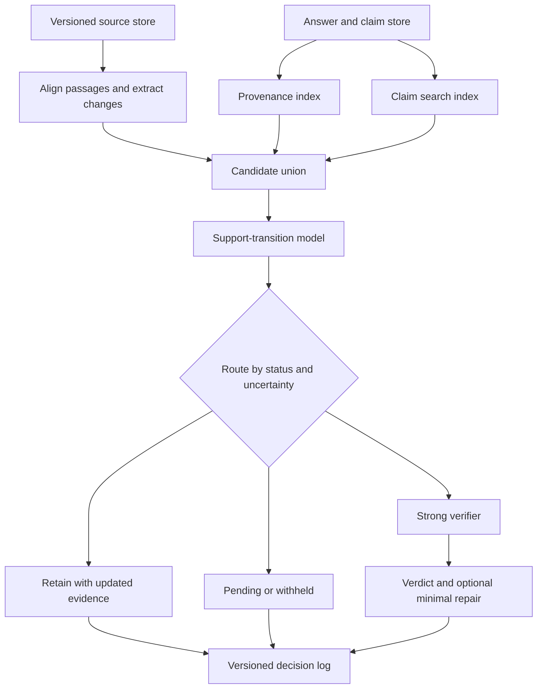

# AFTERMATH: When Sources Change, Which Answers Must Change?

Research proposal and implementation plan · 1 November 2026 · v1.0

**Status:** A proposed study, not completed experiments. Novelty is a defensible hypothesis to test against the listed competitors, not a claim of priority. All dataset sizes, performance targets, and schedules below are proposed unless attributed to a source.

## 1. The decision

Build AFTERMATH as **selective semantic revalidation of stored, evidence-grounded answers under document updates and incomplete provenance**.

An evolving knowledge base can change without invalidating an answer. Conversely, a newly added document can contradict an old answer even when none of its citations changed. AFTERMATH should distinguish these cases, prioritize the answers requiring work, and retain an audit trail of its decisions.

The central research question is: **Can a system recover answers that have lost support at substantially lower total checking cost than exhaustive revalidation, while avoiding unnecessary changes to answers that remain supported?**

The central scientific distinction is between *dependency freshness* and *semantic support*. A new document version is a reason to investigate; it is not automatically evidence that the answer is false. Conversely, unchanged dependency hashes do not establish that an answer remains correct in the presence of new conflicting evidence.

Start with a bounded, versioned document corpus, fixed questions, and previously generated answers. The claim concerns support in that corpus under an explicit temporal and source-authority policy, not truth across the unrestricted Web.

## 2. What the additional research changed

Google Scholar and Semantic Scholar were searched through connected Chrome. Original ACL Anthology and arXiv records were inspected. Relevant full-text sections of FinCacheServe and PACMI were read, including their methods and evaluation assumptions. Other newly added works were verified primarily from original publication records and abstracts. This is a focused novelty audit, not an exhaustive systematic review or a reproduction of the reported results.

| Work | Verified contribution or boundary | Consequence for AFTERMATH |
|---|---|---|
| FinCacheServe, Zeng and Jin, 2026 preprint [13] | Answer reuse guarded by document versions, evidence/tool fingerprints, and serving configuration. Its full text explicitly distinguishes dependency freshness from factual accuracy. | Version checks, reverse dependency indexes, and answer-cache call savings cannot be our novelty. Compare semantic support after changes against this conservative contract. |
| PACMI, Wang et al., 2026 preprint [14] | Typed provenance graph, validity states, cascading invalidation, historical preservation. Its diagnostic benchmark supplies dependency edges, uses six prior memories and a fixed two-hop chain per case. | Graph propagation, historical memory, and stale-premise correction cannot be claimed as new. Study automatically inferred support links, alternative evidence, large archives, and natural update streams. |
| Safe and Sufficient Caching, Verma et al., EMNLP Industry 2026 [15] | Validates cached evidence chunks using source freshness and access constraints before utility ranking. | Distinguish evidence reuse from the semantic state of an existing answer. Keep validity checks separate from cost-based prioritization. |
| HoH, Ouyang et al., ACL 2025 [16] | Evaluates RAG with coexisting current and outdated information, using temporal QA construction. | Fresh retrieval alone is not a sufficient baseline or solution. Include conflicting historical/current passages in evaluation. |
| VersionRAG, Huwiler et al., 2025 preprint [17] | Models document versions and changes in a hierarchy; evaluates version-sensitive QA. | A version graph and temporal filtering are infrastructure, not our main research contribution. |
| GaRAGe, Sorodoc et al., Findings ACL 2025 [18] | Human-curated answers and passage grounding annotations; identifies attribution and deflection weaknesses. | Citation links cannot be treated as complete or perfectly correct evidence dependencies. |
| Sufficient Context, Joren et al., author version revised 2025 [19] | Separates context sufficiency from model utilization; explores guided abstention. | Loss of support must be separated from contradiction, and unresolved cases need a distinct disposition. |

Search results also surfaced CacheSense and OntoCacheRAG. Their primary texts were not verified in this review; they remain pre-submission novelty-audit leads and are not used to substantiate the proposal.

## 3. Concrete example

Consider fictional software documentation. Version 1 states: “Bulk export is available to all paid plans.” An existing answer says: “Your Starter plan supports bulk export.”

| Update | Correct behavior |
|---|---|
| The sentence is moved or rephrased without changing meaning. | Retain the answer and refresh the evidence link if needed. |
| Bulk export becomes Pro-only, effective immediately. | Mark the old current-use answer contradicted and prepare a correction. |
| The original sentence is removed, but another authoritative current page still supports it. | Recover that support and retain the answer. |
| A new release note announces Pro-only availability; the cited page has not changed. | Retrieve the answer through its claim/topic, detect the conflict, apply the declared source/version policy. |
| The new rule applies next month. | Preserve the answer for today; evaluate future-oriented questions under the new rule. |
| The question explicitly asks about version 1. | Keep its historical interpretation; do not silently rewrite it as a current question. |
| Evidence is removed and no replacement is available. | Mark insufficient support; do not invent the opposite answer. |

The interface should display the old answer, old/new source spans, current support status, and the minimal proposed change. These examples are designed cases, not empirical results.

## 4. Scope and contributions

Target three contributions:

1. **Task and benchmark:** answer-support transitions under natural document updates, with unaffected controls, incomplete provenance, source additions, and repeated updates.
2. **Method:** change-aware candidate retrieval plus a trained support-transition model, using inferred evidence links and alternative support; verification escalation is budgeted and measured.
3. **Evaluation:** cost–risk–coverage curves that expose both unsafe retention and overly conservative invalidation, with controlled ablations of the method.

Do not claim that dependency graphs, truth maintenance, temporal QA, semantic caching, claim decomposition, selective prediction, or minimal editing are individually new. The intended contribution is their specific treatment of update-conditioned answer support with uncertain links, and evidence that this treatment improves a meaningful frontier.

Keep automatic rewriting secondary. Core outputs are reliable retain/recheck/withhold decisions and evidence-based explanations. A strong benchmark paper is preferable to an elaborate system with unproven benefits.

## 5. Task definition and labels

At time t, the system has corpus D_t and answer archive A_t. Each answer contains the original question, answer text, answer timestamp, intended temporal scope, and recorded citations. Updates produce D_(t+1). The system predicts support transitions for the existing answers under their original question semantics.

Record two separate concepts:

- **Semantic status:** supported, contradicted, insufficient support, or unresolved source conflict.
- **Workflow status:** unassessed, queued, reviewed, or withheld.

For a mixed answer, label each material claim, then aggregate: any material contradiction prevents an “entire answer supported” label; missing support remains distinct from an explicit contradiction. Preserve correct claims during optional repair. Claims that cannot be decomposed reliably should escalate with their surrounding sentence/answer context.

The primary benchmark starts with answers confirmed supported at t. A secondary mixed-quality track includes previously unsupported answers so the system is not rewarded for attributing every defect to the update.

Use two temporal tracks: rolling-current questions and explicitly version-bound/historical questions. Record both observed time and effective time where available. The benchmark fixes source precedence; it does not assume the newest text always wins.

## 6. Proposed method

### 6.1 Store evidence support when answers are created

Decompose each answer into claims while retaining the original text and question. Propose supporting passage groups and verify them with an entailment model or verifier. Store span offsets, document/version IDs, scope, and confidence. Citation extraction alone does not prove support.

A claim can have alternative support groups. Within a group, several passages may be jointly necessary; across groups, either group may suffice. For example, (passage A AND passage B) OR passage C. This is a representation of estimated support, not a formal proof of natural-language truth. Limit groups to a small retrieved set; do not enumerate all subsets.

### 6.2 Detect and align updates

Keep immutable document versions. Align stable sections/sentences before comparing text so moves and chunk-boundary changes do not look like factual changes. Record additions, deletions, replacements, scope qualifiers, dates, and numeric changes. When alignment is uncertain, expand to the containing section/document rather than assume no impact.

### 6.3 Retrieve candidate answers through two paths

Union two candidate sets:

- **Provenance path:** answers linked to changed or deleted passages, including uncertain links.
- **Discovery path:** search the claim archive using added/changed content, entities, relations, and scope. This catches new contradictions with no old citation edge.

Use a hybrid lexical/dense retriever, followed by a small reranker. A graph-only approach is an explicit ablation. Maintain a separate sentinel audit sample outside the selected set to estimate retrieval misses; it is not a guarantee of completeness.

### 6.4 Train a support-transition model

Input: question and scope, claim, old supporting passages, aligned update, surviving support, and retrieved new evidence. Predict the new support status and whether strong verification is warranted.

Begin with a compact encoder/cross-encoder baseline. Compare direct paired old/new encoding with two independent evidence–claim classifications. Add a small instruction model with parameter-efficient tuning only if the pilot shows that scope or multi-passage reasoning is the bottleneck.

Training losses can combine status classification with a contrastive objective: meaning-changing edits should change the predicted status when appropriate; meaning-preserving edits and unrelated updates should not. Do not impose invariance merely because text embeddings are similar. Keep status prediction and routing distinct so a model can be uncertain without fabricating a verdict.

### 6.5 Resolve alternative support and contradictions

An affected support group triggers inspection of remaining groups and newly retrieved evidence. Surviving support can justify retention, but an unchanged passage is not enough when an authoritative new contradiction is present. Preserve source conflicts rather than arbitrarily selecting the evidence that supports the old answer.

No retrieved replacement means “support not found within this retrieval process,” not a proof that no support exists. Report candidate and evidence-retrieval recall separately.

### 6.6 Budget verification and preserve history

Start with a transparent routing policy: send the highest predicted-impact or most uncertain cases to a stronger verifier, accounting for estimated cost. Compare against risk-only, uncertainty-only, and uniform selection. Learned scheduling is optional, not needed for the first paper.

Fit thresholds using a separate calibration split; sweep them to obtain risk–coverage curves. Claims about conformal or distribution-free guarantees require an actual proof and stated assumptions; this plan makes no such guarantee under evolving distributions.

If a potentially affected answer cannot be checked within budget, mark it pending/withheld. Do not silently call unprocessed answers safe. Measure availability so withholding everything cannot win.

The strong verifier produces structured verdicts with cited old/new spans. Optional editing receives only affected claims and their supporting evidence, then is independently checked. Keep old and new answer versions. When a source update races with verification, commit only against the evaluated corpus version or requeue.

## 7. Data strategy

| Resource | Intended role | What must be added or checked |
|---|---|---|
| VitaminC [1] | Change-sensitive entailment pretraining and paired-evidence supervision. | Preserve paired examples and revision grouping; do not assume every factual edit is a genuine world event or chronological change. |
| FRUIT-WIKI [2] | Evidence-grounded update examples; optional repair evaluation. | It is not an answer-archive impact benchmark; distantly supervised examples need filtering. |
| HoH [16] / DynaQuest [9] | Natural temporal QA cases and changing facts. | Audit accessible versions, licensing, timestamps, and original revision provenance before choosing one as the primary natural track. |
| GaRAGe [18] | Grounding/attribution stress tests where released data permits. | It lacks the required source-update stream; do not imply private passages are downloadable. |
| PACMI [14] | Diagnostic comparison if code/data become accessible. | The inspected paper says release is forthcoming. A faithful reimplementation must be labeled as such. |
| Public versioned software documentation | Out-of-domain application with explicit versions. | Collect and annotate a small new set; verify redistribution permissions and keep entire projects out of training. |

Release availability, licenses, and exact splits were not exhaustively audited here. They are a first-stage implementation gate, not assumptions about ready-made data.

### Proposed benchmark construction

1. Select a before/after revision pair and preserve both versions with timestamps.
2. Build questions and answers from the **before** corpus only; prevent the answer generator from seeing future evidence.
3. Confirm initial support, including temporal scope.
4. Construct an answer pool containing affected claims, nearby unaffected claims, redundant-support cases, and unrelated answers.
5. Apply the actual source update; annotate post-update support independently of the model's selected candidates.
6. Add controlled interventions as a separately reported diagnostic track: citation deletion, alternative-support removal, newly added contradictions, paraphrases, reversions, delayed effective dates.
7. Group revisions by document/entity/project before splitting; use chronological splits within valid groups and separately hold out entities/projects where possible. Never split a positive pair from its contrastive mate.

Natural and synthetic cases must be distinguishable in all reports. For naturally incomplete provenance, audit actual answer citations; random edge deletion is only a controlled stress test, not a substitute.

Pilot target: roughly 100 revision events and 1,000 answer–update judgments, with a balanced diagnostic subset. Main-study target, contingent on annotation effort: at least 1,000 update events, 5,000 or more answer–update judgments, and 500 independently double-annotated held-out judgments. These are planning targets, not existing dataset sizes or sample-size justifications. Use pilot effect sizes and event clustering to determine final statistical power.

Keep gold annotation evidence and support graphs hidden from production methods. An oracle-provenance condition is an upper bound, never the default. LLMs may propose labels; final test labels need human adjudication. Report agreement before adjudication, ambiguity exclusions, and the number of resolved disputes.

## 8. Experiments and baselines

| Baseline | Purpose |
|---|---|
| Exhaustive strong revalidation | Costly reference procedure; still evaluated against human gold, never treated as infallible ground truth. |
| Fixed TTL / periodic refresh | Simple operational baseline. |
| Document-version invalidation | Tests whether a coarse reverse index is enough. |
| Passage-version invalidation | Stronger granular conservative baseline. |
| Changed-text similarity retrieval + shared verifier | Tests whether the proposed learned method beats a practical cheap alternative. |
| Two independent old/new NLI judgments | Isolates the value of learning transitions jointly. |
| Direct strong-LLM prompting on paired evidence | Tests whether a simple prompt already solves the semantic task. |
| PACMI-style propagation | Compare with both oracle and automatically inferred graph inputs; label adaptations explicitly. |
| FinCacheServe-style freshness gating | Implement the documented dependency contract where applicable; distinguish domain adaptation from a reproduction. |
| AFTERMATH | Two-path candidate retrieval, inferred support groups, transition model, budgeted escalation. |

For selection experiments hold the final verifier constant. For verifier experiments hold candidate sets/evidence constant. For system comparisons count all extraction, indexing, diffing, retrieval, inference, repair, and audit cost. Present cold-start and amortized cost over realistic query/update ratios; a large preprocessing bill cannot disappear from accounting.

Primary metrics:

- Affected-answer recall over the full archive, including candidates never retrieved.
- Unsafe retention: unsupported current-use answers incorrectly kept available, with numerator and denominator stated.
- Unnecessary invalidation/editing among answers that remain supported.
- Answer availability/coverage and queue delay, to prevent withholding from gaming safety.
- Total time, tokens, measured model calls, storage and preprocessing cost; report hardware and pricing assumptions if converting to money.
- Claim-level macro F1 across status classes, evidence-span precision/recall, and optional post-edit factuality/preservation.

Main figure: end-to-end verification cost versus unsafe-retention rate, with coverage shown. Supplement with affected-answer recall at fixed budgets. Include realistic low affected-answer prevalence and a balanced diagnostic set, reporting them separately.

Ablations: remove discovery path; remove provenance path; remove alternative support; replace paired model with independent NLI; remove scope; use oracle versus inferred links; disable escalation. Stress archive size, update rate, provenance error, source additions, repeated updates and reversions. Cluster confidence intervals by document/update event; do not treat correlated claims as independent samples. Use several seeds and paired comparisons.

## 9. Project architecture

The diagram groups operations, not separate services. Build one Python research package plus a small API, not a distributed agent platform.

Suggested components: Python/PyTorch for training and evaluation; local lexical/dense indexes for retrieval; SQLite for the pilot, with PostgreSQL optional for the demo; FastAPI for inference/jobs; Next.js for a thin browser interface. Exact model and package versions should be pinned after the data and hardware audit.

Data entities: DocumentVersion; PassageVersion with offsets and lineage; AnswerVersion; Claim with scope; SupportGroup and its members; UpdateEvent; CandidateDecision; VerificationRun with model/prompt/corpus version and cost; ReviewLabel. Keep evidence relations in ordinary tables first. A graph database is not required to represent a dependency graph.

Training and evaluation records must be separate from serving records. Deterministic replay should reconstruct each corpus version, update sequence, candidate list, and verdict. UI user actions should include inspect update, inspect affected answer, compare evidence, approve a proposed repair, and view pending cases. Do not automatically publish corrections to external users.

## 10. Execution plan and gates

Assumption: a small student team, one modest GPU or limited hosted inference, and approximately 10–12 weeks. Adjust after the pilot; these are planning estimates.

| Stage | Deliverable | Exit gate |
|---|---|---|
| Weeks 1–2 | Data/license audit, annotation rubric, 100-event pilot, document/passage/similarity/direct-LLM baselines. | Demonstrate genuine difference between dependency changes and semantic impact; identify enough naturally occurring cases. |
| Weeks 3–4 | Replayable benchmark, human checks, automatic claim/evidence index. | No split leakage; reliable labels; quantify link and retrieval errors. |
| Weeks 5–6 | Compact paired transition model and two-path retrieval. | Improvement over independent NLI and similarity routing on validation data. |
| Weeks 7–8 | Escalation, alternative-support handling, stream replay. | Cost advantages persist with indexing and validation overhead included. |
| Weeks 9–10 | Held-out tests, ablations, uncertainty estimates, cross-domain cases. | Improvement is robust at comparable risk and coverage, not just a single threshold. |
| Weeks 11–12 | Reproducibility package, demo, paper draft and error analysis. | Claims match measured evidence; method and dataset can be independently evaluated. |

Illustrative pilot target: retain at least 95% affected-answer recall while cutting strong-verifier work by roughly half relative to exhaustive checking. This is an engineering go/no-go target, not a promised result, statistical guarantee, or acceptance threshold. Judge success using total cost and uncertainty intervals, not just call count.

If a simple passage index plus NLI matches the proposed method, publish the benchmark and finding if sufficiently valuable; do not add agents or graph complexity to manufacture novelty. If natural selective-update cases are too scarce, narrow the paper to a diagnostic semantic-revalidation benchmark and state its limits. If strong prompting wins cheaply, retain it as the system method and drop unsupported training claims.

## 11. Paper outline and proposal abstract

Working title: **AFTERMATH: When Sources Change, Which Answers Must Change?**

Technical subtitle: **Selective Semantic Revalidation of Grounded Answers under Incomplete Provenance**.

Sections: introduction and counterexample; related work and precise boundary; task and annotation protocol; benchmark; method; experiments; cost and failure analysis; limitations; release and reproducibility.

Proposal abstract (no results claimed):

> Retrieval-augmented systems accumulate answers whose supporting documents continue to evolve. Dependency-based invalidation can discard answers that remain supported, while unchanged citations can miss contradictions introduced elsewhere in the corpus. We propose studying selective semantic revalidation: identifying which existing answers require reconsideration after a source update under incomplete provenance and a limited verification budget. AFTERMATH combines update-conditioned claim retrieval, inferred evidence-support groups, and a trained support-transition model with verification escalation. We propose a benchmark separating natural revision streams from controlled interventions, including meaning-preserving edits, alternative support, source additions, and temporal scope changes. Evaluation will measure unsafe retention, unnecessary invalidation, answer coverage, and total verification cost against exhaustive checking, version-based invalidation, similarity routing, and strong language-model baselines.

For eventual venue selection, prioritize NLP venues if the contribution is a learned semantic task and benchmark; prioritize IR venues if candidate retrieval dominates. Do not select a deadline or assert acceptance prospects before results and current calls are checked.

## 12. Verified reference links

The first twelve were reviewed in the preceding conversation. New close competitors are 13–19. Author lists and publication details for new competitors are provided below; arXiv records are not silently promoted to peer-reviewed venues.

1. Schuster, Fisch, Barzilay. 2021. [Get Your Vitamin C! Robust Fact Verification with Contrastive Evidence](https://aclanthology.org/2021.naacl-main.52/). NAACL.
2. Logan IV, Passos, Singh, Chang. 2022. [FRUIT: Faithfully Reflecting Updated Information in Text](https://aclanthology.org/2022.naacl-main.269/). NAACL.
3. Liska et al. 2022. [StreamingQA](https://proceedings.mlr.press/v162/liska22a.html). ICML.
4. Gao et al. 2023. [RARR](https://aclanthology.org/2023.acl-long.910/). ACL.
5. Chen, Pasupat, Singh, Lee, Guu. 2023. [PURR](https://arxiv.org/abs/2305.14908). Preprint verified.
6. Min et al. 2023. [FActScore](https://arxiv.org/abs/2305.14251). EMNLP, as stated in author record.
7. Kasai et al. 2023. [RealTime QA](https://proceedings.neurips.cc/paper_files/paper/2023/hash/9941624ef7f867a502732b5154d30cb7-Abstract-Datasets_and_Benchmarks.html). NeurIPS Datasets and Benchmarks.
8. Wang et al. 2024. [Factcheck-Bench](https://aclanthology.org/2024.findings-emnlp.830/). Findings EMNLP.
9. Lin, Li, Ng. 2025. [DynaQuest](https://aclanthology.org/2025.findings-acl.1380/). Findings ACL.
10. Piryani, Mert, Jatowt. 2026. [How often do Answers Change? Estimating Recency Requirements in Question Answering](https://arxiv.org/abs/2603.16544). Preprint.
11. Datta, Bhattacharya, Gupta. 2026. [Evaluating the Reliability of LLMs in Faithfully Updating Text](https://aclanthology.org/2026.gem-main.28/). GEM workshop.
12. Liu et al. 2026. [BeyondAtoms](https://aclanthology.org/2026.emnlp-main.289/). EMNLP.
13. Lingteng Zeng, Yifan Jin. 2026. [FinCacheServe: Dependency-Consistent Answer Reuse for Cost-Efficient RAG Serving over Mutable Enterprise Documents](https://arxiv.org/abs/2607.26076). Preprint. Full-text methods and experimental sections inspected.
14. Yiqi Wang, Jiaqi Liu, Jiaqi Zhang, Zhangkai Wu, Yiqun Duan, Mingkai Zheng, Taotao Cai. 2026. [PACMI: Provenance-Aware Cascading Memory Invalidation for Long-Term LLM Agents](https://arxiv.org/abs/2610.05732). Preprint. Full-text scope, method, benchmark and experiment sections inspected.
15. Akshay Verma, Siddharth Pillai, Sambit Das, Deepak Gupta. 2026. [Safe and Sufficient Caching: Validated Evidence Reuse for Production Retrieval-Augmented Generation](https://aclanthology.org/2026.emnlp-industry.75/). EMNLP Industry Track.
16. Jie Ouyang, Tingyue Pan, Mingyue Cheng, Ruiran Yan, Yucong Luo, Jiaying Lin, Qi Liu. 2025. [HoH: A Dynamic Benchmark for Evaluating the Impact of Outdated Information on Retrieval-Augmented Generation](https://aclanthology.org/2025.acl-long.301/). ACL.
17. Daniel Huwiler, Kurt Stockinger, Jonathan Fürst. 2025. [VersionRAG: Version-Aware Retrieval-Augmented Generation for Evolving Documents](https://arxiv.org/abs/2510.08109). Preprint verified.
18. Ionut Teodor Sorodoc, Leonardo F. R. Ribeiro, Rexhina Blloshmi, Christopher Davis, Adrià de Gispert. 2025. [GaRAGe: A Benchmark with Grounding Annotations for RAG Evaluation](https://aclanthology.org/2025.findings-acl.875/). Findings ACL.
19. Hailey Joren, Jianyi Zhang, Chun-Sung Ferng, Da-Cheng Juan, Ankur Taly, Cyrus Rashtchian. [Sufficient Context: A New Lens on Retrieval Augmented Generation Systems](https://arxiv.org/abs/2411.06037). Submitted 2024; inspected author version revised April 2025. Semantic Scholar lists ICLR, but its original venue record was not inspected here.
