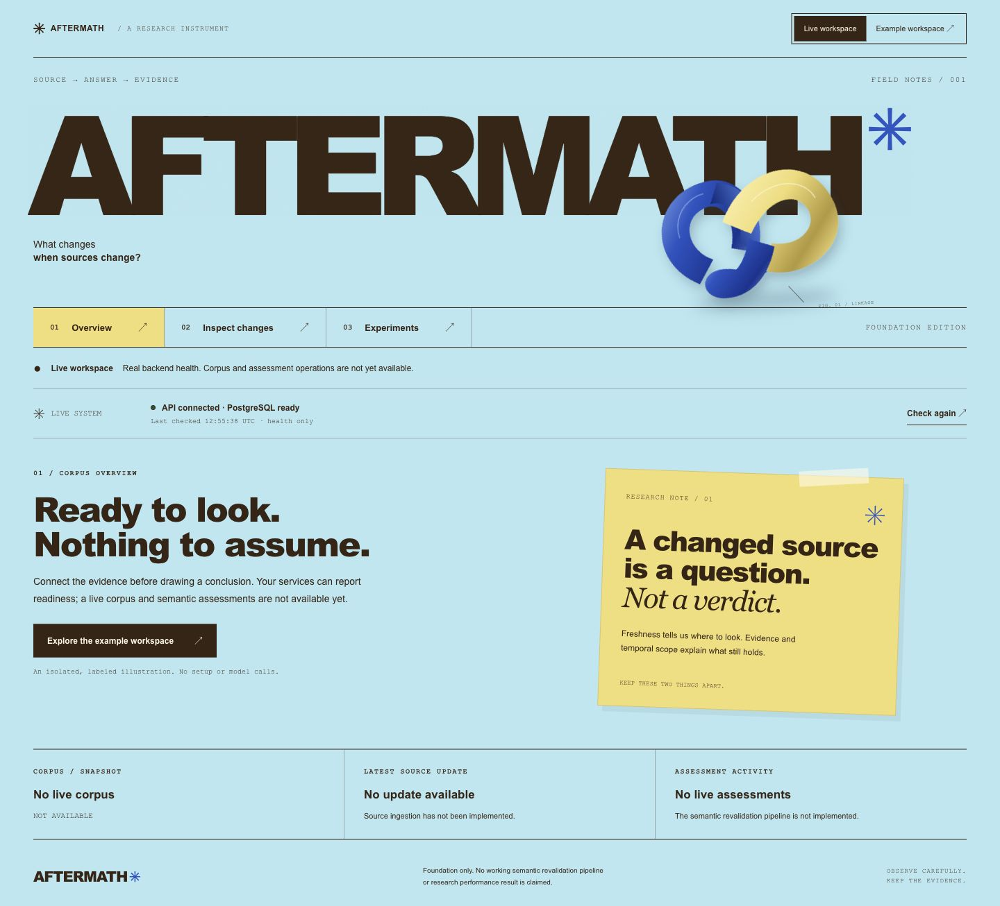
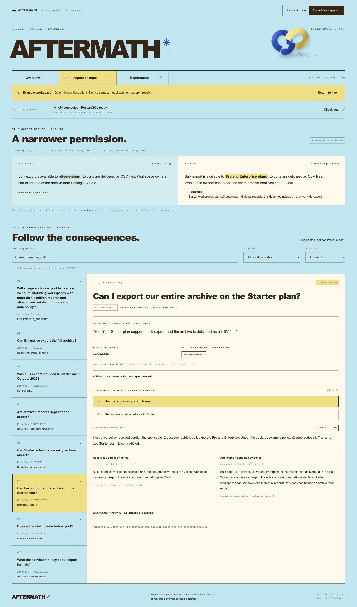
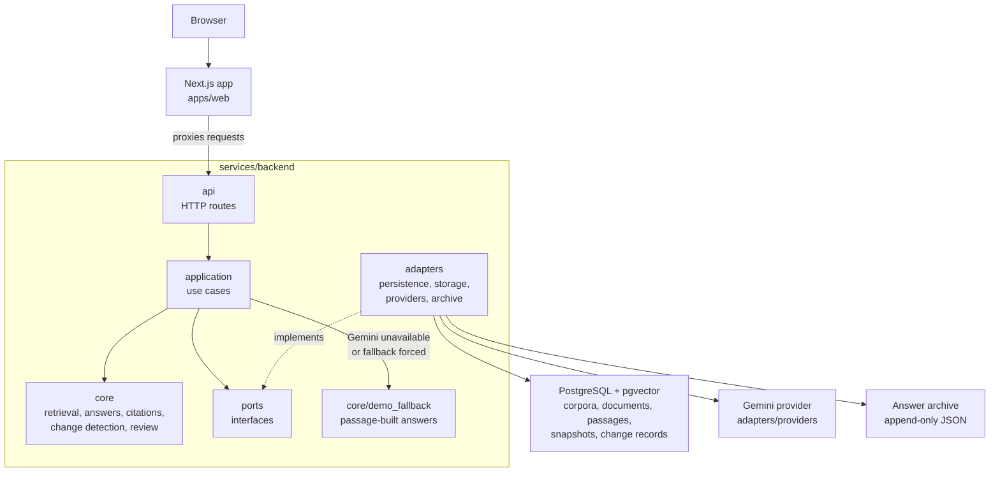

# aftermath

Revalidating archived grounded answers when their source documents change.

## What it is

AFTERMATH is a research prototype. A user uploads documents into a corpus and asks questions. Each answer is grounded: it cites the exact passage it came from, and is archived with that citation at a specific corpus snapshot.

When a document is later revised, AFTERMATH detects which stored passages changed, finds only the archived answers whose cited passage changed, and flags them for reassessment. Answers whose evidence did not change are left alone.






## Architecture

The browser talks to the Next.js app in `apps/web`. That app proxies storage and answer requests to the FastAPI service in `services/backend`.

HTTP routes call application use cases. Use cases depend on core and on ports. Adapters implement those ports. Core holds retrieval, answer and citation checks, change detection, and review. The Gemini adapter produces grounded answers. When Gemini is unavailable, or when the demo fallback is forced, `core/demo_fallback` builds the answer from retrieved passages of the demo documents `plans` and `plans-v2`.

PostgreSQL, with the pgvector extension installed, stores workspaces, corpora, documents, passage versions, snapshots, and change records. Alembic migrations in `services/backend/migrations` manage that schema. Archived answers and reassessments are append-only JSON files written by the archive adapter.



## Tech stack

| Part | Choice |
| --- | --- |
| Frontend | Next.js 16 + React 19 (TypeScript) |
| Backend | FastAPI (Python 3.13) |
| Database | PostgreSQL + pgvector |
| Migrations | Alembic |
| LLM | Google Gemini (with deterministic fallback) |
| Package managers | npm and uv |

## Repository structure

```text
.
├── apps/web/                 Next.js frontend
│   ├── app/
│   ├── components/
│   ├── lib/
│   ├── tests/
│   └── scripts/
├── services/backend/         FastAPI service
│   ├── src/aftermath/
│   │   ├── api/
│   │   ├── application/
│   │   ├── core/
│   │   ├── adapters/
│   │   ├── ports/
│   │   ├── experiments/
│   │   ├── worker/
│   │   └── config.py
│   ├── migrations/
│   └── tests/
├── infra/                    Docker Compose for Postgres with pgvector, on 127.0.0.1:54329
└── docs/                     architecture notes, demo runbook, screenshots
```
